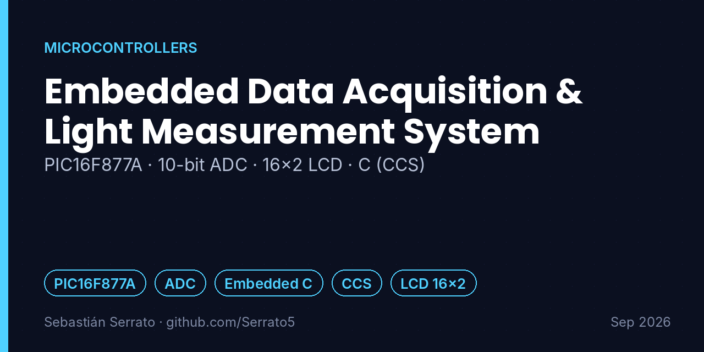
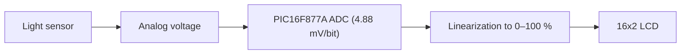

# Embedded Data Acquisition & Light Measurement System

**PIC16F877A · 10-bit ADC · 16x2 LCD · C (CCS)**

`PIC16F877A` `ADC` `Embedded C` `CCS` `LCD 16x2`

## Overview

A data acquisition system on real hardware that measures light intensity, converts it with the microcontroller's ADC and shows it as a percentage on a 16x2 LCD.

## Key features

- **ADC configuration:** Microcontroller registers configured for analog-to-digital conversion with a resolution of 4.88 mV/bit.
- **Linearization firmware:** C firmware converts raw voltage values into light intensity percentages (0–100 %).
- **User interface:** 16x2 LCD controlled for real-time data visualization.

## How it works

## What I learned

- ADC resolution: 5 V / 1024 steps ≈ 4.88 mV per bit.
- Turning raw readings into a meaningful unit for the user.
- Driving a character LCD from a microcontroller.

## Project context

| | |
|---|---|
| Context | Universidad Surcolombiana |
| Dates | Sep 2026 |
| Area | Microcontrollers |

## Resumen en español

Sistema de adquisición de datos con PIC16F877A que mide intensidad de luz: ADC configurado por registros (4,88 mV/bit), firmware en C que convierte el voltaje en porcentaje (0–100 %) y visualización en una LCD 16x2.

---

**About this repository:** the original source code and design files of this project were not preserved. This repository documents what was built, how it works and what I learned, based on my project records. It does not contain reconstructed code.

**Sobre este repositorio:** el código y los archivos originales de este proyecto no se conservaron. Aquí se documenta qué se construyó, cómo funciona y qué aprendí, sin código reconstruido.

**Author:** Sebastián Serrato Ramírez · Electronic Engineering student, Universidad Surcolombiana (Neiva, Colombia) · [LinkedIn](https://www.linkedin.com/in/sebaserrato) · [More projects](https://github.com/Serrato5)
